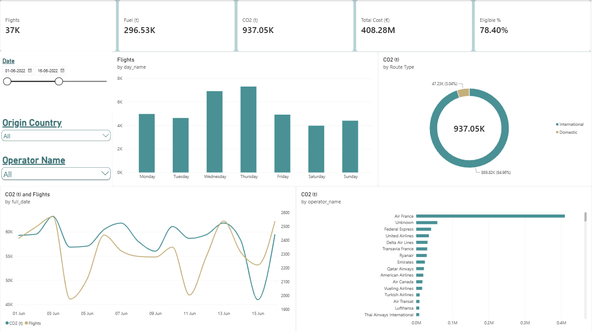
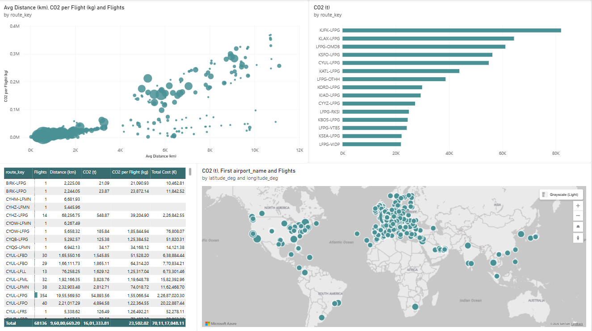
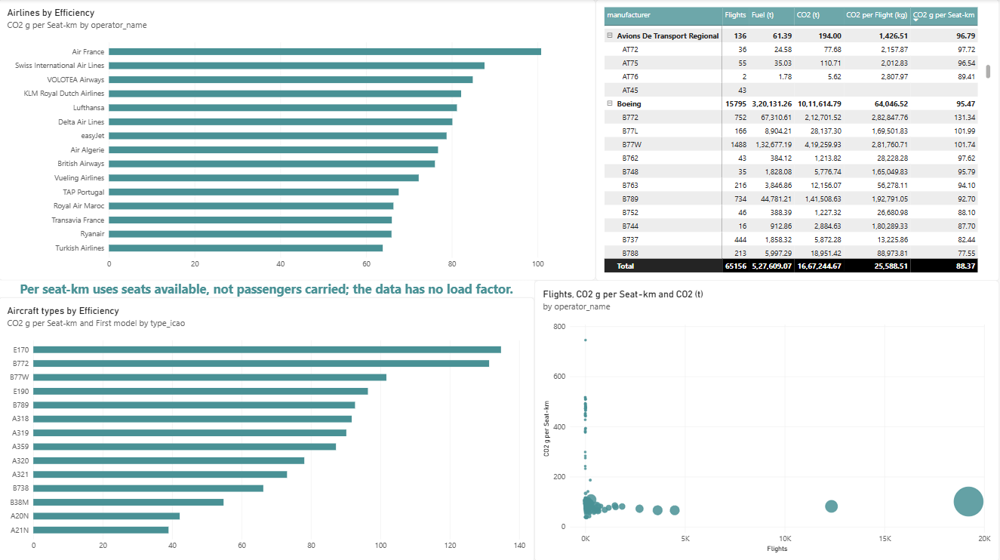
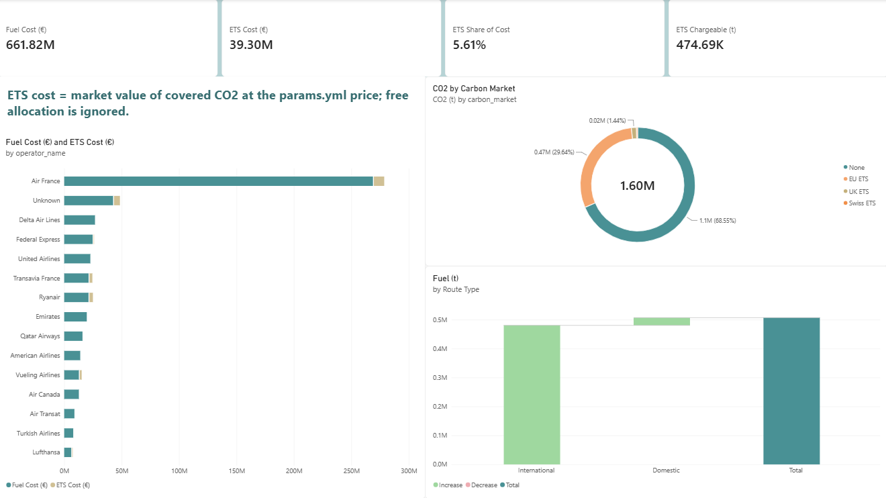
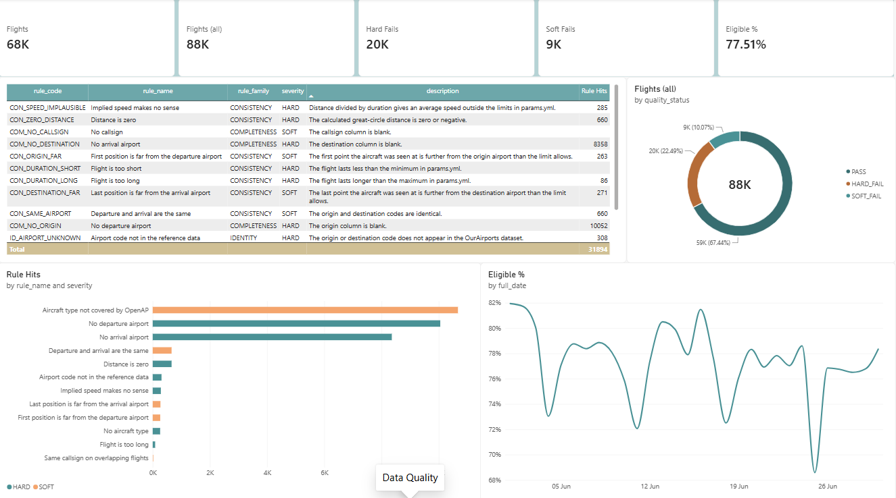

# Flight Energy Performance

Working out how much fuel and CO2 flights to and from French airports
produce, using public flight tracking data — and what those emissions cost
under the EU carbon rules.

**June 2022 in one line:** of 87,903 flights touching French airports, the
59,772 that could be modelled burned 506,751 tonnes of fuel and emitted 1.60
million tonnes of CO2, worth EUR 662 million in fuel and EUR 39 million in
carbon allowances — and **70% of that CO2 falls outside the EU carbon
market.**



The pipeline runs end to end, from raw downloads to a five-page Power BI
dashboard. [See all five pages](#the-dashboard).

---

## What it does

Aircraft broadcast their position every few seconds, and volunteers around
the world record those signals. OpenSky publishes the result as a monthly
CSV: one row per flight, with the departure airport, the arrival airport and
the aircraft type.

That file says nothing about fuel. This project works it out:

1. **Load the flights** for one month, keeping the ones that touch a French
   airport.
2. **Work out the distance** between each pair of airports.
3. **Calculate the fuel and CO2** using [OpenAP](https://github.com/junzis/openap),
   an open aircraft performance model, based on the aircraft type and the
   distance flown.
4. **Put a price on it** — what the CO2 costs under the EU Emissions Trading
   System.
5. **Check the data** before trusting any of it, and report how many flights
   had to be thrown out and why.

Step 5 is a proper part of the project rather than a tidy-up job. The source
data is genuinely messy — in the June 2022 sample, 37% of flights have no
aircraft type and 11% have no departure airport — so any conclusion is only
as good as the filtering behind it.

---

## Where the data comes from

Four files. All direct downloads, no account and no registration.

| Source | Used for | Size | Licence |
|---|---|---|---|
| [OurAirports](https://ourairports.com/data/) | Airport names and coordinates | 13 MB | Public domain |
| [OpenSky flight list](https://zenodo.org/records/7923702) (on Zenodo) | The flights themselves | ~200 MB per month | CC, non-commercial |
| [OpenSky aircraft registry](https://s3.opensky-network.org/data-samples/metadata/) | Fills in missing aircraft types | 61 MB | Free to use |
| [OpenFlights](https://github.com/jpatokal/openflights) | Airline codes to names | 400 KB | ODbL |

Full details, including what the data can and cannot tell you, are in
[`docs/DATA_SOURCES.md`](docs/DATA_SOURCES.md).

Every file that gets used is recorded in the `dim_source` table with its
URL, download date, size, checksum and row count:

```bash
uv run flightperf sources
```

### Two things to know about the data

**One month is loaded: June 2022** — 87,903 flights over 30 days. The
dataset offers any month from January 2019 to December 2022, so loading a
second month is one command, but the analysis as it stands covers June 2022
only.

**Everything is priced at June 2022 market prices**, matching the month of
the flight data — so the money figures mean *"what this traffic cost at the
time"*, not what it would cost today. The carbon figure is the market
**value** of the emissions rather than cash paid: in 2022 airlines still
received a large share of their allowances free, and that is deliberately
ignored.

Loading June 2019 as well would show the COVID collapse and recovery — it is
one command.

**There is no flight path, only the endpoints.** So the distance used is the
straight line between the two airports. Real flights are longer than that,
which means every fuel figure is an underestimate unless corrected. The
correction factor lives in [`config/params.yml`](config/params.yml): +2.96%,
EUROCONTROL's published 2022 en-route flight efficiency figure.

---

## Which flights

Anything departing from or arriving at the French airports listed in
[`config/airports_fr.yml`](config/airports_fr.yml) — 26 airports, from Paris
Charles de Gaulle down to Tarbes.

June 2022 gives about **88,000 flights**, out of 3.2 million worldwide in
that month's file.

Corsican routes are kept as a separate group. France has restricted some
short domestic flights where the train is a realistic alternative, and
Corsica is the obvious case where it is not — which makes those routes a
useful comparison.

---

## How it fits together

```
airports.csv ───┐
                ├─► PostgreSQL ─► SQL view ─► Power BI
flightlist.gz ──┘   (star schema)  (the KPIs)
```

**The transformations are SQL.** The distance calculation, the KPI formulas
and the quality checks are all in [`sql/`](sql/) where they can be read and
tracked in version control. Python does the downloading and the fuel
physics, which SQL cannot do.

**Power BI only displays things.** The DAX stays simple because the
calculations already happened in `core.v_flight_kpi`. A KPI formula hidden
inside the `.pbix` file could not be diffed between versions.

**PostgreSQL.** A real database server, the same kind used at work, and the
one named in most job adverts. Power BI connects to it directly and imports
from the view, so there are no exported files in between — rerun the
pipeline, press Refresh, and the report is up to date.

The 200 MB compressed flight list is streamed into it with `COPY`: Python
unzips a block at a time and passes it straight to the server, so the
uncompressed gigabyte never has to exist as a file.

### Folders

| Folder | What's in it |
|---|---|
| `config/` | Every assumption — prices, thresholds, which airports |
| `sql/01_schema/` | The table definitions |
| `sql/03_marts/` | The view Power BI reads |
| `sql/04_quality/` | The data quality checks |
| `src/flightperf/` | Downloading, fuel model, CLI |
| `powerbi/` | The report file and screenshots |
| `files/` | Project summary document, updated as the work progresses |
| `scripts/` | Helper scripts that aren't part of the pipeline |
| `docs/` | Roadmap, data sources, method notes and results |

### The tables

One fact table, `fact_flight`, at one row per flight — the same grain as the
source file, so no flights have to be reconstructed.

Around it: `dim_date`, `dim_airport`, `dim_aircraft`, `dim_aircraft_type`,
`dim_operator`, `dim_quality_rule` and `dim_source`. Plus
`fact_flight_quality`, which holds one row per problem found per flight.

---

## Running it

Needs [uv](https://docs.astral.sh/uv/) and PostgreSQL. uv downloads Python
3.12 itself; PostgreSQL has to be installed once:

```bash
winget install -e --id PostgreSQL.PostgreSQL.17
```

The installer asks for a superuser password. Copy `.env.example` to `.env`
and put that password in `PGPASSWORD` — `.env` is gitignored, so it never
gets committed.

```bash
uv sync --group dev
uv run flightperf init
uv run flightperf ingest airports
uv run flightperf ingest aircraft
uv run flightperf ingest airlines
uv run flightperf ingest flights --year 2022 --month 6
uv run flightperf build quality
uv run flightperf build fuel
uv run flightperf build validate
uv run flightperf build kpi
uv run flightperf status
```

The ingest commands can be run in any order — the reference data is stored,
so loading the aircraft registry before the flights is not a wasted step.
Reloading reference data after the fuel model has run means running
`build quality`, `build fuel` and `build kpi` again afterwards.

That is the whole setup. The first flight download is about 200 MB and takes
a few minutes; after that it is cached and never fetched again.

`build kpi` turns CO2 into money using the carbon price, the jet fuel price
and the route-extension factor in [`config/params.yml`](config/params.yml).
If any of them is missing it stops and prints what is missing, rather than
treating it as zero.

Each step is separate so that one can be rerun without redoing the download.

### Opening the dashboard

Open [`powerbi/dashboard.pbix`](powerbi/dashboard.pbix) in Power BI Desktop
(Windows, free) and press **Refresh**. It connects to the database with:

| Setting | Value |
|---|---|
| Connector | **PostgreSQL database** — not SQL Server, which fails with a "pre-login handshake" error |
| Server | `localhost:5432` |
| Database | `flightperf` |
| Mode | Import |
| Credentials | Database: `postgres` and the password from `.env` |

A local PostgreSQL install has SSL switched off, so Power BI's first attempt
at an encrypted connection fails. Accept the offer to connect unencrypted,
or untick *Encrypt connections* under File → Options and settings → Data
source settings.

### The reference document

`files/Project_Summary.docx` is the notes file — everything about the
project in one place, written to be read and studied rather than skimmed:
a glossary of the aviation terms, the full detail and links for both data
sources, what the data can and cannot tell you, every table and column,
every quality check, the KPI formulas, the commands, and the progress log.

The Word file is not edited by hand. Static explanations live in
[`scripts/update_summary.py`](scripts/update_summary.py), and the factual
parts — row counts, the quality checks, the columns in each table, which
files were downloaded — are read straight out of the database each time it
runs. So the document cannot quietly go out of date.

```bash
uv run python scripts/update_summary.py
```

Add a line to the progress log in that script whenever a step is finished,
then regenerate.

---

## Things to be careful about

**Assumptions that have not been checked are left empty in
[`config/params.yml`](config/params.yml), and the code stops rather than
carrying on.** A missing carbon price treated as zero would produce a
confident, wrong answer with no warning.

**Distances are straight lines between airports**, corrected upward by
2.96% using EUROCONTROL's 2022 en-route flight efficiency figure. That
covers the en-route phase only, so the full gate-to-gate extension is still
understated.

**Fuel per seat uses the seats the aircraft has, not the passengers on
board.** The source data does not say how full the plane was. So it measures
the efficiency of the capacity offered, not of the people carried, and it is
labelled that way everywhere.

**The fuel model is checked against ICAO and corrected to it.** OpenAP's
cruise burn was compared with ICAO's published fuel table for 16 aircraft
types covering 93% of the CO2. Nine agreed within 15%. The Boeing 777 family
came out 23–37% high and the A320neo and A321neo 23–31% low, so each
checked type is scaled to match ICAO. That lowered total CO2 by 9.4%. The
raw model output is kept alongside (`fuel_burn_kg`), and
`calibrate_to_icao` in [`config/params.yml`](config/params.yml) switches the
correction off. Run `uv run flightperf build validate` to see the
comparison.

**Carbon market coverage follows the 2022 rules, by direction.** Paris →
London was in the EU ETS; London → Paris was in the UK ETS. Paris → Geneva
was in the EU ETS; Geneva → Paris was in the Swiss ETS. Flights between
the EEA and the outermost regions (Réunion, the Canaries, Madeira…) were
exempt. Only the EU ETS share is priced. Sources are in
[`docs/DATA_SOURCES.md`](docs/DATA_SOURCES.md).

**Taxi fuel is not counted.** OpenAP has no model for engines at idle, and
inventing a number would be worse than leaving it out.

---

## Results

June 2022, flights touching French airports:

| | |
|---|---|
| Flights found | 87,903 |
| Usable after the quality checks | 68,136 (77.5%) |
| With a fuel figure | 59,772 |
| Fuel burned | 506,751 tonnes |
| CO2 | 1.60 million tonnes |
| Fuel cost | EUR 662 million |
| Carbon value (EU ETS) | EUR 39 million |
| Share of CO2 outside the EU carbon market | 70% |
| Share of CO2 under no carbon market at all | 68.5% |

The busiest route by emissions is New York JFK to Paris Charles de Gaulle.
Air France accounts for the largest share of any operator. Among short-haul
aircraft, the A320neo family comes out noticeably more efficient per seat
than the older A320 and 737 generation.

Airborne fuel only, with straight-line distances corrected upward by
EUROCONTROL's 2022 en-route efficiency figure (+2.96%) and each checked
aircraft type corrected to ICAO's published fuel burn. Still
underestimates, because taxi fuel is excluded and the distance correction
covers the en-route phase only.

**The most interesting result:** 70% of that CO2 falls outside the EU carbon
market, because the long-haul routes that dominate emissions are not
covered. The UK and Swiss systems pick up only 1.8% more, so 68.5% of the
CO2 from French air traffic carried no carbon price at all.

---

## The dashboard

Five pages in Power BI, built on the `core.v_flight_kpi` view. Every KPI
counts only the flights that passed the quality checks; the last page shows
what was excluded and why.

**1. Overview** — totals, CO2 by day, the weekday pattern, domestic against
international, and the largest emitters by airline.


**2. Routes & Airports** — where the CO2 is emitted. The long-haul routes
into Paris CDG dominate: New York JFK alone is the largest.



**3. Airlines & Aircraft** — efficiency in grams of CO2 per seat-kilometre.
Cargo airlines are excluded, since they have no seats to divide by, and
airlines and types with under 500 flights are hidden so one-off flights do
not dominate the ranking.



**4. Carbon Cost** — fuel cost against EU ETS cost by airline, and how much
of the CO2 the carbon market actually covers.



**5. Data Quality** — how many flights each of the 15 checks rejected. The
two biggest reasons are a missing departure or arrival airport.



---

## Licence

Code is MIT. The data keeps whatever licence it came with — OurAirports is
public domain, the OpenSky flight list is Creative Commons non-commercial.
